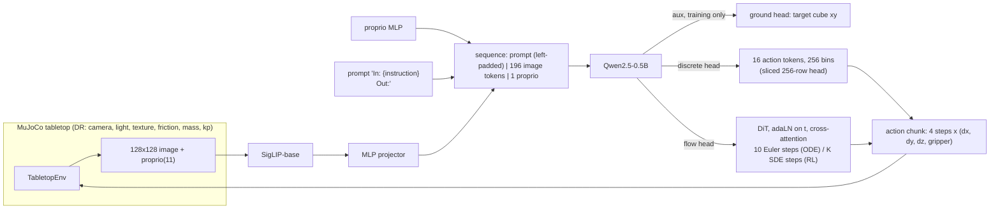
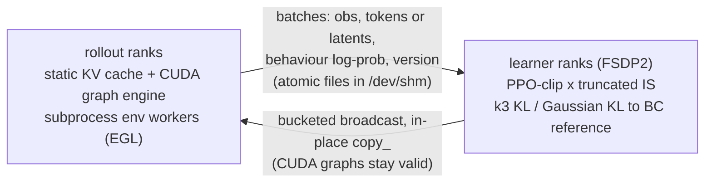

# sim2real-vla: closed-loop VLA post-training on a randomized MuJoCo tabletop

This repository trains a small vision-language-action (VLA) policy for a simulated Franka Panda, evaluates it in
closed loop, and post-trains it with reinforcement learning. The point of the project is the infrastructure around the
policy: distributed training, checkpointing, a decoupled actor-learner RL loop, and an inference path that is
analysed against the hardware limits. The policy itself is small and the tasks are simple.

Numbers in this README come from measured runs; anything not yet measured is marked `TBD`. The final tables are
rendered by `scripts/make_tables.py` from the JSON files in `results/` into `results/tables.md`. The behaviour-cloning
numbers below come from `results/eval_bc_*.json` and `results/probe_bc_*.json`.
Nothing here claims a multi-node run: launches are multi-node-ready (`torchrun` with a c10d rendezvous), but every
reported result is single-node on four A100s that were shared with other users.

## What is in the box

| Area | What it does | Code |
|---|---|---|
| Simulator | MuJoCo tabletop, Franka Panda, three coloured cubes, tasks `reach`, `lift`, `push`; 4-D end-effector delta actions at 10 Hz, damped-least-squares IK | `src/vla/sim/` |
| Domain randomization | Camera, lighting, textures, friction, mass, actuator gains; three splits (`train`, `heldout`, `heldout_photo`) | `sim/randomization.py` |
| Expert and data | Scripted waypoint expert, parallel headless generation to HDF5 shards (with per-frame cube positions and the target index), resumable sampler with early-frame oversampling | `sim/expert.py`, `src/vla/data/` |
| Model | SigLIP-base + 2-layer MLP projector + Qwen2.5-0.5B (0.58B parameters); discrete-token or flow-matching action head; optional auxiliary target-position head | `src/vla/model/` |
| BC training | FSDP2 (also DDP and a DeepSpeed ZeRO-3 path used only in the scaling sweep), bf16, sync or async DCP checkpoints | `src/vla/train/` |
| Evaluation | Batched closed-loop rollouts, Wilson intervals, success relative to the expert ceiling, smoothness and safety metrics; a first-frame grounding probe | `src/vla/eval/`, `scripts/probe_grounding.py` |
| RL | Decoupled actor-learner GRPO with truncated importance sampling; Flow-GRPO for the flow head | `src/vla/rl/` |
| Inference | Eager, static-KV-cache and CUDA-graph decode; latency benchmark with a roofline analysis | `src/vla/infer/` |
| Remote tooling | Setup, rsync, detached launch with exit-code capture, GPU snapshots, quiet-window waiting | `scripts/` |

## Architecture



Decoupled RL topology (one `torchrun` world):



Design notes, in the order a reader is likely to ask:

* **Why a custom simulator.** It gives full control over randomization and the held-out splits and renders headless
  with EGL. The cost is that it is not a published benchmark, so success numbers are only comparable inside this repo.
* **Action tokens.** Actions in [-1, 1] are quantised into 256 bins and appended to the Qwen vocabulary. A chunk of
  4 steps is 16 tokens. The loss is cross-entropy over the 256 action rows only, which equals a logit mask to the
  action vocabulary without materialising a full-vocabulary logits tensor. At inference the head is sliced to those
  256 rows (0.23M parameters instead of about 136M).
* **Prefix order: text first.** The prompt comes before the image tokens, so under causal attention the image tokens
  are encoded already knowing which cube was asked for. The original order (image, proprio, prompt) is still the
  default in `VLAConfig.prefix_order` and in `configs/model_0p5b.yaml`; `configs/model_0p5b_txt.yaml` selects
  `txt_first`. Why this matters is the subject of the next section.
* **Flow head.** A 6-layer DiT (d=512, about 36M parameters) cross-attends to the backbone's hidden states over the
  prompt/image prefix; rectified flow with a Beta(1.5, 1) timestep density; 10 Euler steps at evaluation.
* **Splits.** `train` randomizes within the ranges in `DRConfig`. `heldout` uses disjoint light directions, a wider kp
  range, camera, friction and mass ranges that lie outside the training ranges, and procedural materials not used in
  training. `heldout_photo` adds real photo textures (DTD classes never used in training) on the table and floor.
  Success is reported both absolute and relative to the scripted expert's success on the same split, because the
  expert itself does not reach 100% on the harder splits.
* **Decoupled RL.** The rollout engine and the learner run in different processes. With staleness S=1 the rollout
  for batch k+1 overlaps the learner update on batch k, so batches are at most one policy version old. The behaviour
  log-probability is recorded at generation time and the update uses a truncated importance weight
  `min(pi_old / mu, 2)`, which corrects both the staleness and the numerical gap between the inference engine and the
  training graph. That gap is logged as `engine_mismatch`.
* **Flow-GRPO.** For the flow head the probability-flow ODE is replaced by the marginal-preserving SDE of the
  Flow-GRPO paper (`sigma_t = a * sqrt(t / (1 - t))`, Euler-Maruyama), so each denoising step is Gaussian with a
  closed-form log-probability and KL. This stage is gated on the BC results (see `docs/PLAN_v2.md`) and may not be reported.

## Colour grounding: diagnosis and fix

The first behaviour-cloning models were weak on `reach` and `lift` (15% and 12.5% train success against an expert at
100%), but scored about 50% on `push`. All three tasks name a cube by colour; `push` always starts with the same motion.

**Diagnosis.** A first-frame probe compares the policy's predicted xy motion with the expert's heading towards the
named cube, then swaps the colour word in the instruction and checks again.
* On training episodes the first-frame cosine was 0.39 (reach) and 0.48 (lift).
* Swapping the colour word changed the actions by 0.003 to 0.03 and never changed which cube the arm went to.
* The policy had learned "go to some cube" and ignored the colour word.

Three controls ruled out the data:
* A small CNN given the pixels and a one-hot colour located the named cube to 1.3 cm under full randomization
  (0.3 cm without camera randomization).
* The same VLA, trained only to predict that position, stayed at chance (13 cm) with both datasets.
* So the labels, images and camera randomization were fine; the VLA pathway was not using the word.

**What did not work.**
* An auxiliary loss that predicts the target cube's xy from the last prefix position: its output moved 0.004 across
  colour words and 0.60 across images.
* Adding counterfactual colour queries (swap the word, relabel with the other cube's xy, drop that row from the
  action loss): still at chance.

**What worked: putting the text before the image.**
* With the image first, the image tokens are encoded without the question and a single read-out position has to
  recover the target from them.
* With the text first, every image token attends to the colour word.
* In the position-only diagnostic this broke the plateau at about step 700 (2.3 cm). The image-first model at 5x the
  learning rate stayed stuck.

The final recipe (`configs/bc_ground_disc.yaml`) combines:
* the text-first prefix
* the auxiliary position loss (weight 0.2)
* counterfactual colour queries (p = 0.25)
* 3x oversampling of the first four frames of each episode

The first-frame probe on validation episodes:

| Discrete head | reach cos to expert | lift cos to expert | after colour swap: cos to the new cube / old cube | target position error |
|---|---|---|---|---|
| Before (`bc_disc`, image first, no aux loss) | 0.48 | 0.40 | 0.37 / 0.46 (reach): the swap barely moves the action | not measured |
| Flow head, warm-started (`bc_gflow6`, step 1,000) | 0.97 | 0.98 | 0.96 / 0.06 (reach), 0.97 / 0.06 (lift) | 1.1 cm |
| After (`bc_gdisc3`, step 1,000, discrete) | 0.96 | 0.97 | 0.95 / 0.04 (reach), 0.97 / 0.06 (lift) | 1.3 cm |

The probe gate requires a cosine of at least 0.9 on reach and lift and a colour swap that redirects the arm.

**Flow head.** Training the flow head from scratch with the same recipe did not escape the plateau by step 500,
even with the auxiliary weight raised to 0.2. Its gradient norm in the first 200 steps was 30 to 55 (clipped to 1.0),
against 5 to 20 for the discrete head. Warm-starting the flow model from the grounded discrete backbone
(`init_from`, every weight except the freshly initialised DiT) passes the gate at step 500 (reach 0.96, lift 0.94)
and ends as the strongest BC policy (table below).

## Setup

Local (macOS or Linux, Python 3.11, CPU is enough for the tests and smoke runs; never train on a laptop):

```bash
uv sync                                  # core + dev dependencies; the [gpu] extra is not installed
bash scripts/fetch_dtd.sh                # photo textures for the train / heldout_photo splits (~35 MB subset fallback)
uv run pytest tests -q
```

Server (GPU box, no root; see `.env.example` for the variables):

```bash
cp .env.example .env                     # set VLA_DATA, VLA_RUNS, VLA_CKPT, VLA_LOGS, CUDA_VISIBLE_DEVICES, UV_* paths
bash scripts/remote/sync.sh <host> [remote_dir]      # rsync the code (never touches .env, data, runs)
ssh <host> 'cd vla && bash scripts/remote/setup.sh'  # uv, Python 3.11, torch+cu130, EGL probe, GPU checks
bash scripts/remote/launch.sh <name> "<command>"     # detached tmux run, EXIT code and logs preserved
```

`setup.sh` renders once per MuJoCo EGL device id in a subprocess and keeps only ids whose `GL_RENDERER` names the
A100, so a software or display-card renderer cannot silently produce data. FlashAttention is not built from source
(no prebuilt wheel matched this torch/CUDA combination, and a source build was judged not worth the time); the
attention path is PyTorch SDPA.

## Reproducing each result

Every command below is run from the repository root with `.env` sourced.

1. **Expert ceiling** (`results/expert_ceiling.json`)

   ```bash
   uv run python -m vla.sim.expert --episodes 200 --split all --out results/expert_ceiling.json
   ```

2. **Demonstrations** (about 9,000 successful episodes; one shard per 50 episodes)

   ```bash
   uv run python -m vla.data.generate --config configs/data.yaml --num-workers 32
   # ablation datasets fix one randomization group at nominal values:
   uv run python -m vla.data.generate --config configs/data.yaml --num-workers 32 dr_nominal=[cam]  out_dir=$VLA_DATA/demos_nocam
   ```

3. **Behaviour cloning** (discrete and flow heads, same backbone initialisation, data and seed)

   ```bash
   # baseline (image-first, no grounding loss)
   torchrun --nproc_per_node=4 -m vla.train.bc --config configs/bc.yaml name=bc_disc
   torchrun --nproc_per_node=4 -m vla.train.bc --config configs/bc.yaml name=bc_flow head=flow
   # grounded recipe (text-first prefix, aux position loss, colour swaps, early-frame oversampling)
   torchrun --nproc_per_node=4 -m vla.train.bc --config configs/bc_ground_disc.yaml
   # flow head warm-started from the grounded discrete model
   torchrun --nproc_per_node=4 -m vla.train.bc --config configs/bc_ground_flow.yaml name=bc_gflow6 ground_weight=0.2 \
       init_from=$VLA_CKPT/bc_gdisc3/best.pt
   # first-frame grounding probe (pass/fail gate)
   uv run python scripts/probe_grounding.py --ckpt $VLA_RUNS/bc_gdisc3/best.pt --head discrete \
       --data $VLA_DATA/demos --model-config configs/model_0p5b_txt.yaml --n-train 300 --out results/probe_bc_gdisc3_best.json
   ```

   `stop_at=<step>` saves and exits early so a run can be gated and then resumed on the same schedule.
   `keep_best=true` keeps the checkpoint with the lowest validation action loss as `best.pt`.

   Checkpoints go to `$VLA_CKPT/<name>/ckpt` (latest two kept, DCP shards, optimizer state included);
   `$VLA_RUNS/<name>/final.pt` is weights-only bf16. A run killed at any point resumes with `--resume`.

4. **Closed-loop evaluation** (`results/eval_*.json`)

   ```bash
   uv run python -m vla.eval.rollout_eval --policy vla --ckpt $VLA_RUNS/bc_disc/final.pt \
       --model-config configs/model_0p5b.yaml --head discrete --data-dir $VLA_DATA/demos \
       --splits train,heldout,heldout_photo --tasks reach,lift,push --episodes 200 --n-envs 32 --bf16 --quiet-wait \
       --out results/eval_bc_disc.json
   # grounded model: pass the text-first model config and keep the ground head so the checkpoint loads strictly
   uv run python -m vla.eval.rollout_eval --policy vla --ckpt $VLA_RUNS/bc_gdisc3/best.pt \
       --model-config configs/model_0p5b_txt.yaml --override ground_weight=0.2 --head discrete \
       --data-dir $VLA_DATA/demos --splits train,heldout,heldout_photo --tasks reach,lift,push \
       --episodes 200 --n-envs 32 --bf16 --out results/eval_bc_gdisc3.json
   uv run python -m vla.eval.rollout_eval --policy expert --out results/eval_expert.json
   ```

5. **RL post-training**

   ```bash
   # final discrete recipe (pilot C), 80 iterations, from the grounded discrete BC model
   torchrun --nproc_per_node=2 -m vla.rl.grpo --config configs/rl_pilot_c.yaml name=rl2_s0 seed=0 iterations=80 \
       init_ckpt=$VLA_RUNS/bc_gdisc3/best.pt data_dir=$VLA_DATA/demos
   # no-learning control on the identical rollout seed schedule (for paired comparisons)
   torchrun --nproc_per_node=2 -m vla.rl.grpo --config configs/rl_pilot_c.yaml name=ctrl_disc_lr0 seed=0 iterations=80 \
       lr=0.0 init_ckpt=$VLA_RUNS/bc_gdisc3/best.pt data_dir=$VLA_DATA/demos
   # Flow-GRPO on the grounded flow model
   torchrun --nproc_per_node=2 -m vla.rl.grpo --config configs/rl_flow.yaml name=rlf_s0 seed=0 \
       init_ckpt=$VLA_RUNS/bc_gflow6/best.pt data_dir=$VLA_DATA/demos
   # sampled evaluation next to greedy
   uv run python -m vla.eval.rollout_eval --policy vla --ckpt $VLA_RUNS/rl2_s0/final.pt \
       --model-config configs/model_0p5b_txt.yaml --head discrete --data-dir $VLA_DATA/demos \
       --splits train,heldout,heldout_photo --tasks reach,lift,push --episodes 200 --n-envs 32 --bf16 \
       --reward-components --temperature 1.0 --out results/evalT1_rl2_s0.json
   ```

   `staleness=0` is the serial on-policy baseline. Sampled results depend on `--n-envs` (one generator per wave).

6. **Training-system measurements**

   ```bash
   uv run python scripts/bench_bc_step.py --sweep --gpus 0,1,2,4 --n-gpu 4 --quiet-wait --out results/bench_bc_step.json
   bash scripts/scaling_sweep.sh --out results/scaling.json
   uv run python scripts/profile_step.py --n-gpu 4
   torchrun --nproc_per_node=4 scripts/ckpt_stall_study.py --out results/ckpt_stall.json
   ```

7. **Inference latency** (`results/latency.json`)

   ```bash
   uv run python -m vla.infer.benchmark --ckpt $VLA_RUNS/bc_disc/final.pt --flow-ckpt $VLA_RUNS/bc_flow/final.pt \
       --data-dir $VLA_DATA/demos --quiet-wait --trace results/traces --out results/latency.json
   ```

8. **Tables and plots**

   ```bash
   uv run python scripts/make_tables.py --results results --runs runs_pulled
   ```

## Results

Measured cells are filled in; `TBD` cells are not measured yet.

### Policy results (closed loop, 200 episodes per task and split, fixed seeds)

Success rate with 95% Wilson interval. The GPUs were shared during the BC evaluations; that affects timing only, not success.
The flow head samples noise, so a re-run of the same flow checkpoint moves by up to about 0.04 (inside the interval).

| Policy | Task | Train | Held-out | Held-out photo |
|---|---|---|---|---|
| Scripted expert (ceiling) | reach | 1.00 | 1.00 | 1.00 |
| | lift | 1.00 | 0.92 | 0.92 |
| | push | 0.985 | 0.725 | 0.725 |
| BC, discrete head (baseline) | reach | 0.150 [0.11, 0.21] | 0.125 [0.09, 0.18] | 0.135 [0.09, 0.19] |
| | lift | 0.125 [0.09, 0.18] | 0.085 [0.05, 0.13] | 0.085 [0.05, 0.13] |
| | push | 0.490 [0.42, 0.56] | 0.260 [0.20, 0.32] | 0.285 [0.23, 0.35] |
| BC, flow head (baseline) | reach | 0.185 [0.14, 0.24] | 0.120 [0.08, 0.17] | 0.125 [0.09, 0.18] |
| | lift | 0.165 [0.12, 0.22] | 0.060 [0.03, 0.10] | 0.065 [0.04, 0.11] |
| | push | 0.530 [0.46, 0.60] | 0.245 [0.19, 0.31] | 0.245 [0.19, 0.31] |
| **BC, discrete head, grounded** (`bc_gdisc3`) | reach | **0.855** [0.80, 0.90] | **0.450** [0.38, 0.52] | **0.410** [0.34, 0.48] |
| | lift | **0.610** [0.54, 0.67] | **0.290** [0.23, 0.36] | **0.285** [0.23, 0.35] |
| | push | 0.460 [0.39, 0.53] | 0.205 [0.15, 0.27] | 0.245 [0.19, 0.31] |
| **BC, flow head, grounded** (`bc_gflow6`, warm start) | reach | **0.965** [0.93, 0.98] | **0.545** [0.48, 0.61] | **0.550** [0.48, 0.62] |
| | lift | **0.780** [0.72, 0.83] | **0.345** [0.28, 0.41] | **0.325** [0.26, 0.39] |
| | push | 0.605 [0.54, 0.67] | 0.265 [0.21, 0.33] | 0.300 [0.24, 0.37] |
| BC + GRPO, discrete head (`rl2_s{0,1,2}`, mean over 3 seeds, greedy) | reach | 0.878 | 0.442 | 0.445 |
| | lift | 0.737 | 0.307 | 0.292 |
| | push | 0.527 | 0.260 | 0.265 |
| BC + Flow-GRPO, flow head (`rlf_s{0,1,2}`, mean over 3 seeds) | reach | 0.970 | 0.513 | 0.528 |
| | lift | **0.902** | **0.388** | **0.377** |
| | push | 0.627 | 0.253 | 0.222 |

What the table shows:
* Grounding lifts reach and lift success 3 to 6x on every split, for both heads.
* The grounded flow head is the best BC policy: 0.965 / 0.78 / 0.605 on train, and the smoothest (jerk 3.9 to 10.0).
* Push improves little: it never depended on the colour word.
* The gap between train and the held-out splits (0.855 to 0.45 on reach) is the target for RL post-training.

End-effector jerk (RMS, lower is smoother):
* Grounded discrete model: 6.5 to 11.6 on train and 13.0 to 15.7 on the held-out splits.
* Discrete baseline: 6.2 to 17.9, with most of its successes on push.
* Safety-violation counts and success relative to the ceiling are added when the result JSONs are regenerated.

Randomization ablations (short schedule, one seed, labelled as such) and the data-scaling points: TBD.

### RL post-training

Short version: on the discrete head, RL post-training gives a small success gain on the trained tasks (about +0.03 at
sampling temperature 1) and smoother motion (end-effector jerk 0.72 to 0.93x of BC). Most of its larger greedy-decoding
gain comes from sharpening the action distribution, not from a better policy. On the flow head, Flow-GRPO lifts train
lift success from 0.79 to 0.90 on all three seeds. Held-out generalisation barely moves for either head. The steps below
are in the order they happened, including the parts that did not work.

All RL runs train on `lift` and `push` (train split), 64 episodes per iteration (8 seeds x group of 8), one learner GPU and
one rollout GPU, staleness 1, KL to the BC policy. Evaluations use 200 fixed-seed episodes per task and split.

**1. Round 1 drifted.** The first recipe (`configs/rl.yaml`, 100 iterations, 3 seeds) took about 38 Adam steps per
batch with a token-mean loss. KL to the BC policy reached about 1.9, in-training sampled success fell from 0.67 to
0.31-0.38, and end-effector jerk doubled. Greedy train success rose on reach and lift but held-out push fell from 0.205
to 0.12-0.18. Paired against a no-learning control (step 4) the round-1 policy is 0.14 worse.

**2. Diagnosis and pilot ladder** (`docs/PLAN_v2_rl.md`). Two causes: the token-mean loss weights long (failed) episodes
more, and too many optimiser steps per batch turn noise into a random walk. Three 35-iteration pilots on the same env
seeds: (A) 4 optimiser steps per iteration, (B) plus per-episode loss normalisation and an advantage std floor, (C) plus
an adaptive KL coefficient targeting 0.05 nats per token. All three kept KL at 0.015-0.05 (round 1: 0.57 at the same
point). C was chosen and run for 80 iterations on 3 seeds plus a no-smoothness-penalty ablation.

**3. Greedy evaluation looked like a clear win.** Mean over 3 seeds minus BC, greedy decoding:

| Split | reach | lift | push | EE jerk vs BC |
|---|---|---|---|---|
| train | +0.023 | **+0.127** | +0.067 | 0.74-0.92x |
| held-out | -0.008 | +0.017 | +0.055 | 0.77-0.92x |
| held-out photo | +0.035 | +0.007 | +0.020 | 0.72-0.93x |

**4. Two checks shrank it.**

* *Sampled evaluation.* With actions sampled at temperature 1 (`rollout_eval --temperature 1.0`, same episodes), the BC
  policy is already much better than its own greedy decoding (train reach 0.94 vs 0.855, lift 0.80 vs 0.61), and the RL
  policies match it: mean minus BC is -0.052 to +0.017 in every cell. RL mostly moved the greedy policy toward what the
  sampled policy already did. The jerk reduction survives sampling (train push 10.5 to 8.4-9.1).
* *A seed confound in the training curve.* The in-training metric used to accept the recipe compared late iterations
  with early ones. Rollout env seeds depend only on the iteration index, so that compares different, easier or harder,
  scenes. A control run with the learning rate set to zero, on the identical seed schedule, shows the same "improvement"
  (+0.026 discrete, +0.079 flow) with no learning at all. Paired against that control at each iteration (iterations
  40-79), the gain is:

| Run | Paired success gain at T=1 (± 1 s.e.) |
|---|---|
| Round 1, seed 0 | -0.143 ± 0.020 |
| Pilot C (35 iterations; iterations 17-34) | +0.030 ± 0.016 |
| Final, seeds 0 / 1 / 2 | +0.028 ± 0.012 / +0.022 ± 0.017 / +0.040 ± 0.014 |
| Final without jerk penalties | +0.016 ± 0.016 (and higher held-out jerk: 14 vs 12) |
| Flow-GRPO, seeds 0 / 1 / 2 | +0.027 ± 0.008 / +0.033 ± 0.010 / +0.016 ± 0.012 |

The plan gated Flow-GRPO on a +0.05 gain. The confounded metric read +0.083 and the flow runs went ahead; the corrected
gain is about +0.03, so by the plan's rule they would not have run. They are reported as exploratory.

**5. Flow-GRPO.** The flow head (`bc_gflow6`) is fine-tuned with SDE rollouts (Euler-Maruyama, sigma_t = 0.7 sqrt(t/(1-t)),
5 steps), per-step Gaussian log-probabilities and a closed-form KL; only the DiT head trains. Evaluation uses the
10-step ODE with sampled initial noise. Against BC re-evaluated through the identical command
(`results/eval_bc_gflow6_rlpipe.json`), mean over 3 seeds minus BC: train lift +0.107 (0.795 to 0.895-0.910 on every
seed), train push +0.032, held-out lift +0.078, held-out photo lift +0.032, reach -0.005 to -0.037, held-out push -0.027
and +0.012. Two BC evaluations of the same flow checkpoint differ by up to 0.09 in a single cell (held-out photo push
0.30 vs 0.21), so only the train-lift gain is clearly outside evaluation noise.

### Distributed training

All on one node, 0.5B model (582M parameters), real demonstration data, `configs/bc.yaml`, global batch 256 unless
stated. GPUs 0 and 1 were shared with other users' inference servers, so many rows carry the `contended` flag
(see "Measurement protocol").

| Measurement | Value |
|---|---|
| Step throughput, baseline vs tuned (4 GPUs, FSDP2) | 594 samples/s, MFU 37.5% to 866 samples/s, MFU 54.7% (1.46x) |
| 1 / 2 / 4 GPU scaling efficiency (FSDP2) | 1.00 / 0.95 / 0.94 without activation checkpointing, 1.00 / 0.95 / 0.93 with it |
| 1 / 2 / 4 GPU scaling efficiency (DDP) | 1.00 / 0.96 / 0.93 for both settings |
| 1 / 2 / 4 GPU scaling efficiency (DeepSpeed ZeRO-3) | 1.00 / 0.91 / 0.86 without activation checkpointing, 1.00 / 0.93 / 0.89 with it; 2.8x slower than FSDP2 at 4 GPUs |
| Per-GPU peak memory at 4 GPUs, FSDP2 vs DDP | 12.5 vs 25.8 GB; with activation checkpointing 4.4 vs 13.6 GB |
| Checkpoint stall per save, sync vs async (`/dev/shm`, 7.0 GB) | 4.97 s vs 0.99 s (0.20x) and 4.92 s vs 1.25 s (0.25x) in two runs, median over 5 saves each |
| Kill-and-resume loss difference (4 GPUs, steps 41-60 after resume) | max 3.2e-4 sync, 6.4e-4 async; noise floor before the kill 1.9e-4 / 5.5e-4 |

Step throughput ladder (`results/bench_bc_step.json`, 4 GPUs, FSDP2, 20 timed steps per row, each row adds to the one above):

| Configuration | samples/s | MFU | Peak memory per GPU | Contended |
|---|---|---|---|---|
| Baseline: reshard after forward, no prefetch, micro-batch 32 x 2 accumulation, eager, fused AdamW | 594 | 37.5% | 13.8 GB | no |
| + `reshard_after_forward=False` | 613 | 38.7% | 14.5 GB | no |
| + explicit forward/backward prefetch | 612 | 38.6% | 14.5 GB | no |
| + micro-batch 64, no accumulation | 684 | 43.2% | 25.0 GB | yes |
| + `torch.compile` per transformer block | **866** | **54.7%** | 19.6 GB | yes |
| Ablation: micro-batch 64 row with fused AdamW off | 517 | 32.7% | 25.0 GB | yes |

The two largest gains are fewer, larger micro-batches (+12%) and per-block compilation (+27%). The last two rows ran
while other users' jobs were on GPUs 0 and 1, so their gains are lower bounds rather than inflated. Not resharding after
forward costs 0.8 GB per GPU for +3%. Explicit prefetch gave nothing on top of it: profiler traces of both settings
(`results/traces/fsdp2_4gpu_prefetch{0,1}.json.gz`) are for viewing in Perfetto. The unfused AdamW costs 24%.

Scaling sweep (`results/scaling.json`, 120 steps, median of 2 repeats; the repeats agree within 1%):

| Backend | GPUs | Act. ckpt | samples/s | MFU | Efficiency | Peak memory per GPU |
|---|---|---|---|---|---|---|
| FSDP2 | 1 / 2 / 4 | off | 193 / 367 / 723 | 49.7 / 47.2 / 46.5% | 1.00 / 0.95 / 0.94 | 19.0 / 14.7 / 12.5 GB |
| FSDP2 | 1 / 2 / 4 | on | 149 / 283 / 554 | 38.5 / 36.4 / 35.6% | 1.00 / 0.95 / 0.93 | 10.9 / 6.5 / 4.4 GB |
| DDP | 1 / 2 / 4 | off | 139 / 269 / 516 | 35.9 / 34.6 / 33.2% | 1.00 / 0.96 / 0.93 | 25.8 at every size |
| DDP | 1 / 2 / 4 | on | 110 / 213 / 409 | 28.3 / 27.3 / 26.3% | 1.00 / 0.97 / 0.93 | 13.6 at every size |

What it shows:
* FSDP2 memory falls with world size as parameters, gradients and optimizer state are sharded. DDP memory stays the
  same at every size. At 4 GPUs FSDP2 needs half of DDP's memory, and with activation checkpointing a third.
* Both backends keep 93-96% scaling efficiency up to 4 GPUs. A 0.5B model on NVLink A100s is far from
  communication-bound, so this does not tell us how they would scale across nodes.
* FSDP2 is also faster than DDP on a single GPU, but the comparison is not like for like. The FSDP2 path keeps bf16
  parameters (`MixedPrecisionPolicy`), while DDP keeps fp32 parameters under bf16 autocast and pays for the casts.
* Activation checkpointing costs 21-23% throughput and cuts peak memory 43-65%.
* DeepSpeed ZeRO-3 (`results/scaling_ds.json`, same protocol, DeepSpeed 0.19.9 with default bucket and prefetch
  settings) is the slowest backend and scales worst; see the table below. It shards like FSDP2, but its memory falls
  less with world size, and at 4 GPUs it needs 16.2 GB against FSDP2's 12.5 GB. The cause of the gap was not profiled.
  The DeepSpeed settings were not tuned, so this compares defaults, not the best each backend can do.
  * The logged MFU for ZeRO-3 is wrong (0.2-0.3%). Under ZeRO-3 the FLOP estimate counts the partitioned parameter
    tensors, which are empty outside a gather. The MFU in the table is recomputed from throughput with FSDP2's FLOPs
    per sample, since both train the same model.
  * The first sweep did not produce these rows. On DeepSpeed 0.19.9, `torch.optim.lr_scheduler.LambdaLR` rejected the
    wrapped `DeepSpeedZeroOptimizer_Stage3`, so all 12 runs exited at startup. The scheduler is now built on the plain
    AdamW and passed to `deepspeed.initialize`.

| Backend | GPUs | Act. ckpt | samples/s | MFU (recomputed) | Efficiency | Peak memory per GPU |
|---|---|---|---|---|---|---|
| ZeRO-3 | 1 / 2 / 4 | off | 76 / 138 / 259 | 19.4 / 17.7 / 16.7% | 1.00 / 0.91 / 0.86 | 21.6 / 18.4 / 16.2 GB |
| ZeRO-3 | 1 / 2 / 4 | on | 53 / 98 / 187 | 13.6 / 12.6 / 12.0% | 1.00 / 0.93 / 0.89 | 12.4 / 7.7 / 5.5 GB |

Checkpointing (`results/ckpt_stall.json`, `results/ckpt_stall_v2.json`, 4 GPUs, 7.0 GB DCP checkpoint including
optimizer state):
* On `/dev/shm`, a synchronous save stalls training 4.92-4.97 s. An asynchronous save stalls it 0.99 s in one run and
  1.25 s in the other, for staging to pinned host memory. That is 0.20x and 0.25x of sync.
  * The plan's bar was under 0.20x. One run is at the bar and the other misses it, so the bar is not claimed as met.
  * Both runs shared GPUs with other users' jobs. An idle step took 0.19 s in the first run and 0.30 s in the second.
  * The write itself overlaps training. Steps slow by about 0.1 s while it runs, and the checkpoint is published in
    6.5-6.7 s.
* NFS (`/home2`) is not measured. Its saves fail at about 67-70 s in both modes with `OSError: [Errno 28] No space
  left on device` from `os.fsync`. The filesystem has 163 TB free and a plain 2 GB write succeeds at 106 MB/s, so a
  per-user quota with less than 7 GB left is the likely cause. The async stall before the failure was 0.5-1.5 s
  against 67 s for sync, so on a slow filesystem an async save would hide almost all of the write.

Kill-and-resume (`results/resume_gpu.json`): 4 GPUs, 60 steps, checkpoint every 20 steps.
* The killed run hard-exits after step 47, like `kill -9`, with no save or flush. It is then resumed with `--resume`.
  Its losses are compared with an uninterrupted reference run.
* **Sync:** resumes from step 40. The replayed steps 41-47 have bit-identical losses to the first time through. After
  resume the losses differ from the reference by at most 3.2e-4 (relative 7.9e-5). That is about the 1.9e-4 gap the
  two runs already had before the kill, from nondeterministic GPU kernels.
* **Async:** resumes from step 20, not 40, by design.
  * The step-40 save takes about 6.5 s to publish, but the process died 7 steps (about 2.5 s) after the save started.
    The incomplete step-40 directory was never pointed to by `latest`.
  * So the run fell back to the last complete checkpoint. It lost 27 steps of work, but its state was not
    corrupted. The loss difference after resume is at most 6.4e-4, against a 5.5e-4 noise floor.

Two operational failures from this study are also recorded:
* The first resume run was invalid. Leftover checkpoints from the scaling sweep had filled `/dev/shm`, so every save
  failed. The training loop logs and continues past a failed save, and the "resumed" run had retrained from scratch.
  The test script now checks free space, fails on any failed save, and checks that `resume_from` matches.
* After a failed async save, one run deadlocked a few steps later (all ranks at 0% GPU for 3 hours). It could not be
  reproduced on CPU. A related bug was fixed: when the save fails before starting on only some ranks, the ranks
  disagreed and waited on each other. Now all ranks drop that save, rebuild the save group and keep training. The
  DataLoader also has a timeout now, and the next resume run will dump every thread's stack if it hangs.

### Decoupled RL

| Measurement | Value |
|---|---|
| Rollout-side env-steps/s while generating (1+1, discrete) | 610 CUDA-graph engine vs 318 static-cache engine (1.9x) |
| Weight-sync latency (learner to rollout, NCCL broadcast) | median 25-39 ms (full model), 5-9 ms (flow, DiT only); 5.8 s on a contended GPU pair |
| Median `engine_mismatch` (rollout vs learner log-prob, same weights) | 0.011 discrete (static-cache engine), 0.032 flow; truncated-IS clip fraction 0.0 |
| Return, success and KL curves | `$VLA_RUNS/<run>/metrics.jsonl` and TensorBoard; KL at iteration 80: 0.034-0.065 |

Throughput study (`results/rl_throughput.json`): 20 iterations per configuration, medians over iterations 3-19,
64 episodes per rollout GPU per iteration, discrete head. S is the staleness bound: S=0 alternates rollout and learning,
S=1 lets the rollout GPU generate batch k+1 with weights k while the learner trains on batch k.
The 1+1 runs used the two quiet GPUs and were interleaved S=0/S=1 twice (the repeats agree within 2%); the 2+2 and
1+3 runs also used two GPUs that other users were loading at up to 78-93% and are marked contended.

| Topology (learner + rollout GPUs) | Engine | S=0 episodes/s | S=1 episodes/s | S=1 / S=0 | Learner idle at S=0 |
|---|---|---|---|---|---|
| 1+1 | CUDA graph | 3.22 | 4.71 | **1.46x** | 0.33 |
| 1+1 | static cache | 2.15 | 4.68 | 2.18x | 0.41 |
| 2+2 (contended) | CUDA graph | 5.24 | 6.47 | 1.23x | 0.28 |
| 1+3 (contended) | CUDA graph | 4.30 | 4.44 | 1.03x | 0.17 |

What it shows:
* Overlap pays off exactly where generation and learning take comparable time. At 1+1 with CUDA graphs, S=1 removes
  the learner's idle third and gives 1.46x (the plan's bar was 1.3x). With the slower static engine there is more idle
  time to hide, so the gain is 2.18x, and S=1 makes the two engines equally fast because the learner is now the
  bottleneck (rollout idle 1.4 s per iteration with the static engine, 7.4 s with graphs).
* 1+3 is learner-bound: one learner GPU has to train on 192 episodes per iteration, the three rollout GPUs sit idle
  about 35 s of each 44 s iteration, and overlap has nothing to hide (1.03x). Adding rollout GPUs only helps with more
  learner GPUs.
* 2+2 scales episodes/s 1.4x over 1+1 at S=1, below linear; its weight sync took 187 ms against 23 ms at 1+1, which
  points at the contended GPUs, but this run cannot separate that from the extra broadcast hop.
* `engine_mismatch` rises from 0.009 at S=0 to 0.011 at S=1: one policy version of staleness, corrected by truncated
  importance sampling (clip fraction 0).

The CUDA-graph decode engine first produced the wrong tokens (33% agreement with eager, RL `engine_mismatch` 1.12).
Cause: `transformers` 5.22's `StaticLayer.update` ignores `cache_position` and advances its own write counter, so the
three graph warm-up steps shifted every later KV write by three slots. The fix saves and restores those counters around
capture; after it, token agreement is 1.0. The RL runs above use the static-cache engine, which is bit-exact with eager.

### Inference latency (p50 ms per query of one 4-step chunk)

| Row | Batch 1 | Batch 64 | Token agreement vs row 2 | Measured / HBM floor |
|---|---|---|---|---|
| 1 fp32 eager, no cache | TBD | TBD | TBD | TBD |
| 2 bf16 eager, no cache | TBD | TBD | TBD | TBD |
| 3 bf16 + KV cache | TBD | TBD | TBD | TBD |
| 4 row 3 + sliced action head | TBD | TBD | TBD | TBD |
| 5 row 4 + static cache + CUDA graph | TBD | TBD | TBD | TBD |
| 6 flow head, 10 steps, CUDA graph | TBD | TBD | not applicable | TBD |

At batch 1 the decode step is memory-bound (about 1 FLOP per byte against an A100 ridge near 150 FLOP per byte).
The benchmark reports the bytes read per token, the HBM floor at 2.0 TB/s and the measured-to-floor ratio, so the
remaining gap can be attributed to launch overhead rather than guessed at.

## Measurement protocol on shared GPUs

The four A100s used here were shared with other users' jobs, some at 60-99% utilisation. Therefore:

* Processes are pinned with `CUDA_DEVICE_ORDER=PCI_BUS_ID` and `CUDA_VISIBLE_DEVICES`, and memory is reported only
  as process-local `max_memory_allocated`, never from `nvidia-smi` totals.
* Every timing result embeds a GPU snapshot before and after the run (utilisation, foreign compute processes and their
  memory) and a `contended` flag. Contended numbers are kept and marked, not discarded.
* `scripts/quiet_wait.py` waits up to 20 minutes for a quiet window before a benchmark; on timeout the run goes ahead
  and is flagged.
* A-versus-B comparisons are interleaved (ABAB) and repeated, and the tables report median and range, not a single run.
  The `contended` flag is derived from utilisation and can under-report when foreign processes are not visible
  (for example inside a container).

## Status

Done:
* Simulator, randomization splits and data pipeline.
* Distributed BC with resumable checkpoints.
* Evaluation and the grounding probe.
* Grounded discrete BC model.
* Grounded flow BC model (warm-started from the grounded discrete backbone).
* RL post-training: round 1 (drifted, kept as the negative baseline), recipe pilots, final discrete GRPO on 3 seeds plus
  a no-penalty ablation, learning-rate-zero controls, sampled evaluation, and exploratory Flow-GRPO on 3 seeds.
* Decoupled-RL throughput study: S=0 vs S=1 on 1+1, 2+2 and 1+3 GPU topologies, CUDA-graph vs static engine.
* Training-system study: step-throughput ladder, FSDP2 and DDP scaling and memory on 1/2/4 GPUs, sync vs async
  checkpoint stall on `/dev/shm`, and a GPU kill-and-resume check for both checkpoint modes.
* The inference and benchmark code paths exist and are covered by CPU tests (352 passing, 5 skipped: 4 GPU-only, 1 macOS-only). Their GPU results are
  not measured yet.

Fixed along the way:
* An rsync `--delete` removed the first set of result JSONs on the server. They were regenerated from the same
  checkpoints, and `sync.sh` now protects `results/`.
* The CUDA-graph decode engine wrote KV entries three slots off after warm-up (see "Decoupled RL"); fixed and GPU-verified.
* The first RL recipe drifted, and the metric used to accept the second was confounded by the rollout seed schedule;
  both are documented under "RL post-training" with the corrected, paired numbers.

Next:
* NFS checkpoint stall, once there is quota for a 7 GB checkpoint.
* Randomization ablations on the grounded recipe.
* Latency benchmark.
* Demo videos.

## Limitations

* The tasks are short, scripted-expert-solvable manipulation tasks in simulation. The held-out splits probe robustness
  to randomization, not sim-to-real transfer, and no real-robot result is claimed.
* The scripted expert is not perfect on the held-out splits (low friction and heavy cubes), so absolute held-out success
  is bounded by that ceiling; success relative to the ceiling is reported next to it.
* Only the 0.5B backbone is trained end to end. FSDP2 memory savings at larger scale are not demonstrated unless a
  1.5B measurement appears in the memory table.
* RL results are from 3 seeds on two trained tasks (`lift`, `push`). The seeds vary action sampling and minibatch
  order only: all runs share the same rollout env-seed schedule, which is also why late-vs-early training curves are
  confounded and are reported paired against a learning-rate-zero control. Confidence intervals are Wilson intervals
  over episodes within a seed, not across seeds.
* The RL recipe was chosen with a metric later found to be confounded (see "RL post-training"); the Flow-GRPO runs it
  unlocked are exploratory.
* The CUDA-graph decode path depends on the installed `transformers` version; the engine falls back to the static-cache
  eager path and reports the reason if graph capture fails.
* The grounding fix was found and tuned on the `train` split's validation episodes. The held-out splits were only
  evaluated after the recipe was fixed, so they were not used to choose it.
* The grounding recipe adds an auxiliary label (the target cube's position) that a real-robot dataset would need to
  provide, for example from a detector or from the end position of the demonstration.
* Flow-GRPO uses a coarse K-step grid whose first step starts at `t = 1 - 1/(2K)`; this is an approximation of the
  paper's setup and is noted where its results are reported.

## Repository layout

```
configs/    model, data, BC and RL configs (YAML, key=value overrides on the command line)
scripts/    remote setup/sync/launch, sweeps, profiling, benchmarks, make_tables.py
src/vla/    sim/  data/  model/  train/  rl/  eval/  infer/  utils/
tests/      CPU tests (tiny model, gloo): env and DR, data, model, training and resume, eval, RL loop, tables
results/    small committed artifacts (JSON, tables, plots, demo videos)
docs/       the build plans
```
