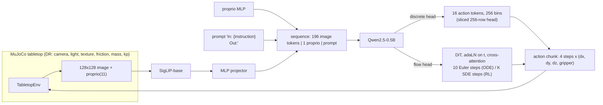
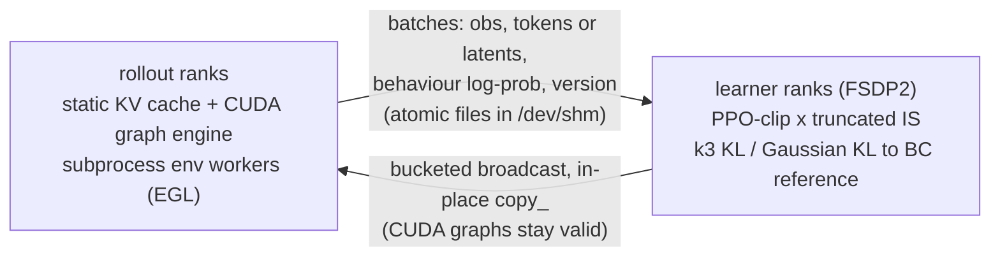

# sim2real-vla: closed-loop VLA post-training on a randomized MuJoCo tabletop

This repository trains a small vision-language-action (VLA) policy for a simulated Franka Panda, evaluates it in
closed loop, and post-trains it with reinforcement learning. The point of the project is the infrastructure around the
policy: distributed training, checkpointing, a decoupled actor-learner RL loop, and an inference path that is
analysed against the hardware limits. The policy itself is small and the tasks are simple.

All numbers in this README are placeholders (`TBD`) until the corresponding result file exists in `results/`.
`scripts/make_tables.py` renders those files into `results/tables.md`; copy the tables from there.
Nothing here claims a multi-node run: launches are multi-node-ready (`torchrun` with a c10d rendezvous), but every
reported result is single-node on four A100s that were shared with other users.

## What is in the box

| Area | What it does | Code |
|---|---|---|
| Simulator | MuJoCo tabletop, Franka Panda, three coloured cubes, tasks `reach`, `lift`, `push`; 4-D end-effector delta actions at 10 Hz, damped-least-squares IK | `src/vla/sim/` |
| Domain randomization | Camera, lighting, textures, friction, mass, actuator gains; three splits (`train`, `heldout`, `heldout_photo`) | `sim/randomization.py` |
| Expert and data | Scripted waypoint expert, parallel headless generation to HDF5 shards, resumable sampler | `sim/expert.py`, `src/vla/data/` |
| Model | SigLIP-base + 2-layer MLP projector + Qwen2.5-0.5B (0.58B parameters); discrete-token or flow-matching action head | `src/vla/model/` |
| BC training | FSDP2 (also DDP and a DeepSpeed ZeRO-3 path used only in the scaling sweep), bf16, sync or async DCP checkpoints | `src/vla/train/` |
| Evaluation | Batched closed-loop rollouts, Wilson intervals, success relative to the expert ceiling, smoothness and safety metrics | `src/vla/eval/` |
| RL | Decoupled actor-learner GRPO with truncated importance sampling; Flow-GRPO for the flow head | `src/vla/rl/` |
| Inference | Eager, static-KV-cache and CUDA-graph decode; latency benchmark with a roofline analysis | `src/vla/infer/` |
| Remote tooling | Setup, rsync, detached launch with exit-code capture, GPU snapshots, quiet-window waiting | `scripts/` |

## Architecture



Decoupled RL topology (one `torchrun` world):



Design notes, in the order a reader is likely to ask:

* **Why a custom simulator.** It gives full control over randomization and the held-out splits and renders headless
  with EGL. The cost is that it is not a published benchmark, so success numbers are only comparable inside this repo.
* **Action tokens.** Actions in [-1, 1] are quantised into 256 bins and appended to the Qwen vocabulary. A chunk of
  4 steps is 16 tokens. The loss is cross-entropy over the 256 action rows only, which equals a logit mask to the
  action vocabulary without materialising a full-vocabulary logits tensor. At inference the head is sliced to those
  256 rows (0.23M parameters instead of about 136M).
* **Flow head.** A 6-layer DiT (d=512, about 36M parameters) cross-attends to the backbone's hidden states over the
  prompt/image prefix; rectified flow with a Beta(1.5, 1) timestep density; 10 Euler steps at evaluation.
* **Splits.** `train` randomizes within the ranges in `DRConfig`. `heldout` uses disjoint light directions, a wider kp
  range, camera, friction and mass ranges that lie outside the training ranges, and procedural materials not used in
  training. `heldout_photo` adds real photo textures (DTD classes never used in training) on the table and floor.
  Success is reported both absolute and relative to the scripted expert's success on the same split, because the
  expert itself does not reach 100% on the harder splits.
* **Decoupled RL.** The rollout engine and the learner run in different processes. With staleness S=1 the rollout
  for batch k+1 overlaps the learner update on batch k, so batches are at most one policy version old. The behaviour
  log-probability is recorded at generation time and the update uses a truncated importance weight
  `min(pi_old / mu, 2)`, which corrects both the staleness and the numerical gap between the inference engine and the
  training graph. That gap is logged as `engine_mismatch`.
* **Flow-GRPO.** For the flow head the probability-flow ODE is replaced by the marginal-preserving SDE of the
  Flow-GRPO paper (`sigma_t = a * sqrt(t / (1 - t))`, Euler-Maruyama), so each denoising step is Gaussian with a
  closed-form log-probability and KL. This stage is gated on the BC results (see `docs/PLAN_v2.md`) and may not be reported.

## Setup

Local (macOS or Linux, Python 3.11, CPU is enough for the tests and smoke runs; never train on a laptop):

```bash
uv sync                                  # core + dev dependencies; the [gpu] extra is not installed
bash scripts/fetch_dtd.sh                # photo textures for the train / heldout_photo splits (~35 MB subset fallback)
uv run pytest tests -q
```

Server (GPU box, no root; see `.env.example` for the variables):

```bash
cp .env.example .env                     # set VLA_DATA, VLA_RUNS, VLA_CKPT, VLA_LOGS, CUDA_VISIBLE_DEVICES, UV_* paths
bash scripts/remote/sync.sh <host> [remote_dir]      # rsync the code (never touches .env, data, runs)
ssh <host> 'cd vla && bash scripts/remote/setup.sh'  # uv, Python 3.11, torch+cu130, EGL probe, GPU checks
bash scripts/remote/launch.sh <name> "<command>"     # detached tmux run, EXIT code and logs preserved
```

`setup.sh` renders once per MuJoCo EGL device id in a subprocess and keeps only ids whose `GL_RENDERER` names the
A100, so a software or display-card renderer cannot silently produce data. FlashAttention is not built from source
(no prebuilt wheel matched this torch/CUDA combination, and a source build was judged not worth the time); the
attention path is PyTorch SDPA.

## Reproducing each result

Every command below is run from the repository root with `.env` sourced.

1. **Expert ceiling** (`results/expert_ceiling.json`)

   ```bash
   uv run python -m vla.sim.expert --episodes 200 --split all --out results/expert_ceiling.json
   ```

2. **Demonstrations** (about 9,000 successful episodes; one shard per 50 episodes)

   ```bash
   uv run python -m vla.data.generate --config configs/data.yaml --num-workers 32
   # ablation datasets fix one randomization group at nominal values:
   uv run python -m vla.data.generate --config configs/data.yaml --num-workers 32 dr_nominal=[cam]  out_dir=$VLA_DATA/demos_nocam
   ```

3. **Behaviour cloning** (discrete and flow heads, same backbone initialisation, data and seed)

   ```bash
   torchrun --nproc_per_node=4 -m vla.train.bc --config configs/bc.yaml name=bc_disc
   torchrun --nproc_per_node=4 -m vla.train.bc --config configs/bc.yaml name=bc_flow head=flow
   ```

   Checkpoints go to `$VLA_CKPT/<name>/ckpt` (latest two kept, DCP shards, optimizer state included);
   `$VLA_RUNS/<name>/final.pt` is weights-only bf16. A run killed at any point resumes with `--resume`.

4. **Closed-loop evaluation** (`results/eval_*.json`)

   ```bash
   uv run python -m vla.eval.rollout_eval --policy vla --ckpt $VLA_RUNS/bc_disc/final.pt \
       --model-config configs/model_0p5b.yaml --head discrete --data-dir $VLA_DATA/demos \
       --splits train,heldout,heldout_photo --tasks lift,push --episodes 200 --n-envs 32 --bf16 --quiet-wait \
       --out results/eval_bc_disc.json
   uv run python -m vla.eval.rollout_eval --policy expert --out results/eval_expert.json
   ```

5. **RL post-training**

   ```bash
   torchrun --nproc_per_node=2 -m vla.rl.grpo --config configs/rl.yaml name=rl_disc_seed0 seed=0 \
       init_ckpt=$VLA_RUNS/bc_disc/final.pt data_dir=$VLA_DATA/demos staleness=1
   ```

   `staleness=0` is the serial on-policy baseline. `head=flow` selects Flow-GRPO.

6. **Training-system measurements**

   ```bash
   uv run python scripts/bench_bc_step.py --sweep --gpus 0,1,2,4 --n-gpu 4 --quiet-wait --out results/bench_bc_step.json
   bash scripts/scaling_sweep.sh --out results/scaling.json
   uv run python scripts/profile_step.py --n-gpu 4
   torchrun --nproc_per_node=4 scripts/ckpt_stall_study.py --out results/ckpt_stall.json
   ```

7. **Inference latency** (`results/latency.json`)

   ```bash
   uv run python -m vla.infer.benchmark --ckpt $VLA_RUNS/bc_disc/final.pt --flow-ckpt $VLA_RUNS/bc_flow/final.pt \
       --data-dir $VLA_DATA/demos --quiet-wait --trace results/traces --out results/latency.json
   ```

8. **Tables and plots**

   ```bash
   uv run python scripts/make_tables.py --results results --runs runs_pulled
   ```

## Results

Placeholders only. Each cell is replaced from `results/tables.md` when the underlying file exists.

### Policy results (closed loop, 200 episodes per task and split, fixed seeds)

| Policy | Task | Train success % [95% CI] | Held-out | Held-out photo | EE jerk RMS | Violations per episode |
|---|---|---|---|---|---|---|
| Scripted expert | lift / push | TBD | TBD | TBD | TBD | TBD |
| BC, discrete head | lift / push | TBD | TBD | TBD | TBD | TBD |
| BC, flow head | lift / push | TBD | TBD | TBD | TBD | TBD |
| BC + RL (mean ± std over TBD seeds) | lift / push | TBD | TBD | TBD | TBD | TBD |

Randomization ablations (short schedule, one seed, labelled as such) and the data-scaling points: TBD.

### Distributed training

| Measurement | Value |
|---|---|
| Step throughput, baseline vs tuned configuration (samples/s, MFU) | TBD |
| 1 / 2 / 4 GPU scaling efficiency, FSDP2 vs ZeRO-3, with and without activation checkpointing | TBD |
| Per-GPU peak memory, FSDP2 vs DDP | TBD |
| Async vs sync checkpoint stall, `/dev/shm` vs NFS | TBD |
| Kill-and-resume loss difference | TBD |

### Decoupled RL

| Measurement | Value |
|---|---|
| env-steps/s, S=0 vs S=1, per topology | TBD |
| Weight-sync latency | TBD |
| Mean `engine_mismatch`, importance-weight clip fraction | TBD |
| Return, success and KL curves | TBD |

### Inference latency (p50 ms per query of one 4-step chunk)

| Row | Batch 1 | Batch 64 | Token agreement vs row 2 | Measured / HBM floor |
|---|---|---|---|---|
| 1 fp32 eager, no cache | TBD | TBD | TBD | TBD |
| 2 bf16 eager, no cache | TBD | TBD | TBD | TBD |
| 3 bf16 + KV cache | TBD | TBD | TBD | TBD |
| 4 row 3 + sliced action head | TBD | TBD | TBD | TBD |
| 5 row 4 + static cache + CUDA graph | TBD | TBD | TBD | TBD |
| 6 flow head, 10 steps, CUDA graph | TBD | TBD | not applicable | TBD |

At batch 1 the decode step is memory-bound (about 1 FLOP per byte against an A100 ridge near 150 FLOP per byte).
The benchmark reports the bytes read per token, the HBM floor at 2.0 TB/s and the measured-to-floor ratio, so the
remaining gap can be attributed to launch overhead rather than guessed at.

## Measurement protocol on shared GPUs

The four A100s used here were shared with other users' jobs, some at 60-99% utilisation. Therefore:

* Processes are pinned with `CUDA_DEVICE_ORDER=PCI_BUS_ID` and `CUDA_VISIBLE_DEVICES`, and memory is reported only
  as process-local `max_memory_allocated`, never from `nvidia-smi` totals.
* Every timing result embeds a GPU snapshot before and after the run (utilisation, foreign compute processes and their
  memory) and a `contended` flag. Contended numbers are kept and marked, not discarded.
* `scripts/quiet_wait.py` waits up to 20 minutes for a quiet window before a benchmark; on timeout the run goes ahead
  and is flagged.
* A-versus-B comparisons are interleaved (ABAB) and repeated, and the tables report median and range, not a single run.
  The `contended` flag is derived from utilisation and can under-report when foreign processes are not visible
  (for example inside a container).

## Limitations

* The tasks are short, scripted-expert-solvable manipulation tasks in simulation. The held-out splits probe robustness
  to randomization, not sim-to-real transfer, and no real-robot result is claimed.
* The scripted expert is not perfect on the held-out splits (low friction and heavy cubes), so absolute held-out success
  is bounded by that ceiling; success relative to the ceiling is reported next to it.
* Only the 0.5B backbone is trained end to end. FSDP2 memory savings at larger scale are not demonstrated unless a
  1.5B measurement appears in the memory table.
* RL results are from a small number of seeds on one task family; confidence intervals are Wilson intervals over
  episodes within a seed, not across seeds.
* The CUDA-graph decode path depends on the installed `transformers` version; the engine falls back to the static-cache
  eager path and reports the reason if graph capture fails.
* Flow-GRPO uses a coarse K-step grid whose first step starts at `t = 1 - 1/(2K)`; this is an approximation of the
  paper's setup and is noted where its results are reported.

## Repository layout

```
configs/    model, data, BC and RL configs (YAML, key=value overrides on the command line)
scripts/    remote setup/sync/launch, sweeps, profiling, benchmarks, make_tables.py
src/vla/    sim/  data/  model/  train/  rl/  eval/  infer/  utils/
tests/      CPU tests (tiny model, gloo): env and DR, data, model, training and resume, eval, RL loop, tables
results/    small committed artifacts (JSON, tables, plots, demo videos)
docs/       the build plans
```
